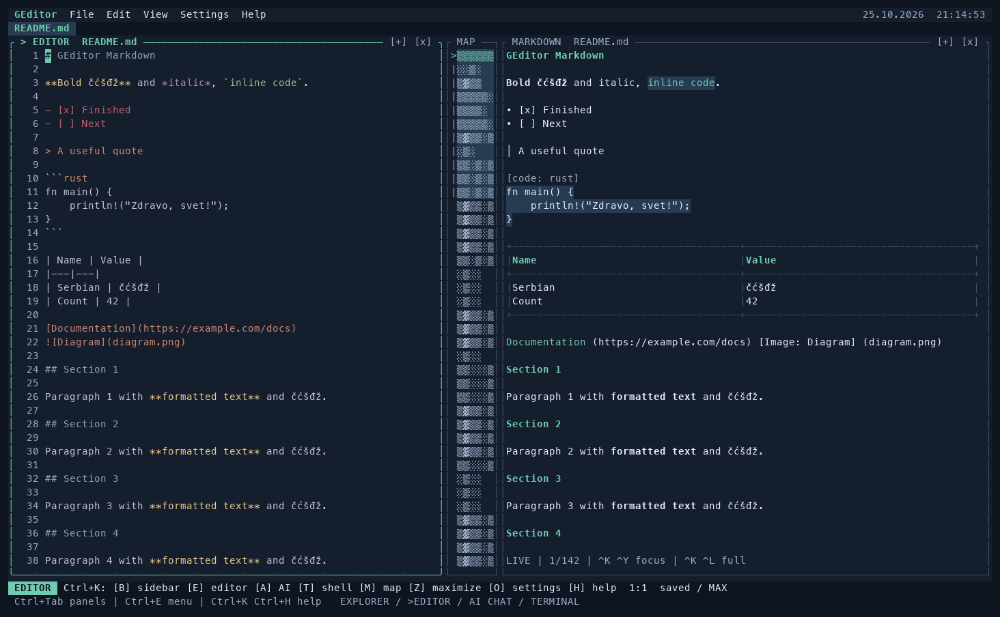

# GEditor

A free terminal code editor written in Rust, with a file explorer, live Markdown preview, an integrated shell and optional AI chat.

Created by **Miodrag Gromilic and OpenAI**. Licensed under **MIT OR Apache-2.0**.

[Releases](https://github.com/gromilicx/Geditor/releases) · [Builds](https://github.com/gromilicx/Geditor/actions) · [Homebrew tap](https://github.com/gromilicx/homebrew-tap)



## Install

### Homebrew

```sh
brew install gromilicx/tap/geditor
ge .
```

Supports Apple Silicon macOS and Linux x64/ARM64. To upgrade:

```sh
brew update
brew upgrade geditor
```

If you previously installed GEditor manually, check `type -a ge`: an old executable in `~/.local/bin` can take precedence over Homebrew.

### Windows and standalone downloads

Download your platform's archive from [Releases](https://github.com/gromilicx/Geditor/releases), extract it, then run GEditor in a terminal. No Rust installation is needed.

| Platform | CPU | Archive | Minimum |
|---|---|---|---|
| macOS | Apple Silicon ARM64 | `geditor-VERSION-macos-arm64.tar.gz` | macOS 11; Homebrew has its own OS requirements |
| Linux | Intel/AMD x64 | `geditor-VERSION-linux-x64.tar.gz` | glibc 2.35+ |
| Linux | ARM64 | `geditor-VERSION-linux-arm64.tar.gz` | glibc 2.35+ |
| Windows | Intel/AMD x64 | `geditor-VERSION-windows-x64.zip` | Windows 10+ |
| Windows | ARM64 | `geditor-VERSION-windows-arm64.zip` | Windows 11 ARM64 |

On Windows, from the extracted folder:

```powershell
.\ge.exe .
.\ge.exe README.md
```

Add that folder to your user PATH to run `ge` anywhere. Windows Terminal is recommended.

For a manual macOS/Linux installation, from the extracted folder:

```sh
mkdir -p "$HOME/.local/bin"
install -m 755 geditor "$HOME/.local/bin/geditor"
ln -sfn geditor "$HOME/.local/bin/ge"
```

Ensure `~/.local/bin` is in PATH. Linux GNU archives are not Alpine/musl builds. Intel Mac and 32-bit ARM builds are not included. Release archives include `SHA256SUMS` for verification; they do not currently have Apple Developer ID or Windows code-signing certificates.

## Use

```sh
ge .
ge /path/to/project
ge src/main.rs
ge README.md
```

With no open file, the editor shows the date and a digital clock. `File`, `Edit`, `View`, `Settings` and `Help` menus work with both keyboard and mouse. `[+]` expands a panel and `[x]` hides it. On narrow screens, the focused panel is shown; cycle focus to reveal the others.

### Main shortcuts

| Shortcut | Action |
|---|---|
| Ctrl+Tab / Ctrl+Shift+Tab | Next / previous enabled panel |
| Ctrl+K, Ctrl+F | Portable next-panel fallback |
| Ctrl+E | Menu, outside the shell |
| Ctrl+K, Ctrl+V | Menu, from every panel |
| Ctrl+N / Ctrl+O | New file / open file or directory |
| Ctrl+P | Quick Open project files |
| Ctrl+S / Ctrl+W | Save / close file |
| Ctrl+F / Ctrl+G | Search current buffer / workspace |
| Ctrl+U / Ctrl+R | Undo / redo |
| Ctrl+A / Ctrl+C / Ctrl+X / Ctrl+V | Select all / copy / cut / internal paste |
| Ctrl+Q | Quit; repeat to discard unsaved changes |

For a two-part shortcut, press Ctrl+K, release it, then press the second Ctrl combination:

| Second combination | Action |
|---|---|
| Ctrl+B / Ctrl+E | Toggle explorer / editor |
| Ctrl+A / Ctrl+T | Toggle AI / shell |
| Ctrl+M | Toggle minimap |
| Ctrl+Z | Maximize / restore focused panel |
| Ctrl+R | Restore saved default layout |
| Ctrl+C | Hide focused panel |
| Ctrl+S | Save As; refuses to overwrite existing files |
| Ctrl+D / Ctrl+U | Next / previous file tab |
| Ctrl+N / Ctrl+P | Next / previous search match |
| Ctrl+O | Settings |
| Ctrl+H / Ctrl+I | Help / About |
| Ctrl+K | Send Ctrl+K to the shell |

The shell keeps its normal Ctrl+C/D/L/E and other controls. Use Ctrl+Tab or the Ctrl+K commands to leave it. No function keys are required. Some terminals intercept Ctrl+Tab; Ctrl+K, Ctrl+F is the fallback. Paste from the system clipboard using your terminal's paste command. The internal clipboard works across open file tabs.

## Markdown

Markdown files open with an editable source and live preview. It follows unsaved changes, undo and redo. Try `ge examples/markdown-demo.md`.

- **Ctrl+K, Ctrl+W:** preview on/off.
- **Ctrl+K, Ctrl+L:** full preview / split view.
- **Ctrl+K, Ctrl+Y:** switch source/preview focus.

Use arrows, PageUp/PageDown, Home/End or the wheel to scroll. Esc returns to source. The preview is read-only; Ctrl+S saves the original Markdown file.

Supports headings, paragraphs, bold/italic/strikethrough, lists, checklists, quotes, tables, inline/fenced code, links and footnotes. Images display their alt text and path. HTML is shown as text; JavaScript/CSS are not executed and external resources are not fetched. This is a terminal renderer, with a visible limit of 20,000 formatted rows. The full source remains editable within the editor's file limits.

## Search

Ctrl+F searches the active buffer, including unsaved edits. Ctrl+G searches the project in the background and uses the current content of open named buffers. Results show `file:line:column` (one-based Unicode character columns). Enter or click opens the file and selects the exact match.

Inside search: Ctrl+C toggles case, Ctrl+W whole words, Ctrl+R regex, Ctrl+D hidden files, Ctrl+A ignored/build folders, Ctrl+T the file filter, Ctrl+S runs/repeats, and Ctrl+U clears the field. Filters include `*.rs,*.toml` and `src/**`. Arrows, Home/End, Delete and Backspace edit the query. Project search starts with Enter; current-buffer search updates immediately.

By default `.gitignore`, hidden files and build folders are respected. `.git` and symlink directories are always skipped. Search is line-based rather than a multiline regex engine. For responsiveness it is capped at 5,000 matches, 20,000 files, 100,000 visits, depth 40, 64 MiB read and 15 seconds. Skipped files and reached limits are displayed.

## Settings and AI

Open Settings with Ctrl+K, Ctrl+O. Ctrl+Tab or Ctrl+N/P switches sections; Enter edits a field or opens a dropdown. Ctrl+S saves, Esc discards. Settings include themes/custom colors, ANSI color modes, ASCII borders, indentation, line numbers, panel defaults/sizes, Markdown preview and AI settings. Font family and font size are controlled by your terminal; standard TUI protocols cannot set them portably.

Settings locations:

- macOS/Linux: `~/.config/geditor/settings.json`.
- Windows: `%APPDATA%\GEditor\settings.json`.
- Overrides: `GEDITOR_CONFIG_DIR` or `XDG_CONFIG_HOME`.

Unix settings directories/files use 0700/0600 permissions. Saved API keys are **local plaintext**, not encrypted. You can instead select the environment profile and use `OPENAI_API_KEY` without saving the key in settings.

In Settings/AI choose a profile, enter its key, refresh the model list, select a text model and save. The default endpoint is the OpenAI Responses API at `https://api.openai.com/v1`; custom endpoints must be Responses-compatible. HTTPS is required except for localhost. Redirects are disabled.

A chat message sends up to 12 recent messages and, only when Include file context is enabled, up to 16 KB of the active buffer. Opening the editor or changing settings does not send code. Requests use `store: false`; the editor never applies AI changes automatically. GEditor is free; API providers may charge separately. Automated AI tests use a local mock server, not paid API calls.

## Build and release

Rust 1.88+ and native C build tools are required to build; the release workflow uses Rust 1.97.1. macOS needs Apple Command Line Tools; Windows MSVC builds need Visual Studio C++ tools. End users of release binaries do not need Rust.

```sh
cargo fmt --check
cargo test --release --locked
cargo clippy --release --all-targets --locked -- -D warnings
cargo build --release --locked
```

The release workflow tests and packages each target on its own OS/CPU runner. [RELEASING.md](RELEASING.md) describes the version/tag, draft release, checksum and Homebrew update process.

## Current limits

GEditor is an MVP, without LSP/autocomplete, a debugger, Git diff or external file-change watching. Opening files is limited to valid UTF-8 text, 2 MiB and 65,535 lines. Syntax highlighting covers the first 3,000 lines. Close a saved tab and reopen it to reload external changes. A VT-compatible interactive terminal is required; `TERM=dumb` is unsupported. At least 80×24 is recommended; narrow layouts adapt, and all panels together require more width.

## License

Choose either [MIT](LICENSE-MIT) or [Apache-2.0](LICENSE).
